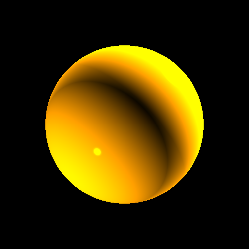
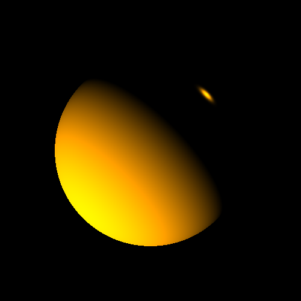
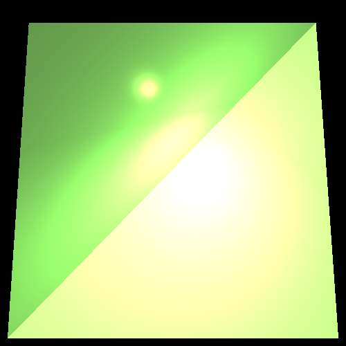
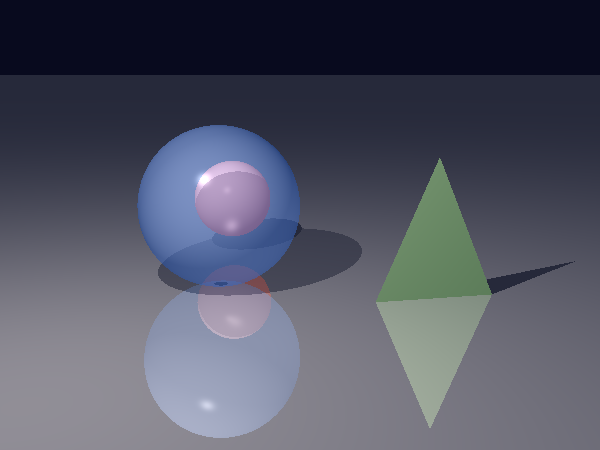

# Java 3D Rendering Engine

A 3D rendering engine developed in Java using ray tracing, vector mathematics, lighting calculations, and object-oriented design.

## Features
  - 3D scene rendering using ray tracing
  - Geometric intersection calculations
  - Camera and ray construction
  - Multiple light sources and lighting calculations
  - Material properties and shading
  - Shadows, including partial shadows cast by partly transparent objects
  - Transparency and reflection, computed recursively with a stopping condition
  - Vector and point-based mathematical computations
  - Object-oriented software design
  - Automated testing with JUnit

## Technologies
  - Java
  - JUnit
  - Object-Oriented Programming (OOP)
  - Ray Tracing
  - Computer Graphics

## How It Works

The rendering process follows these main steps:

1. **Camera:** Generates rays through the pixels of the image.
2. **Ray Intersection:** Checks each ray for intersections with objects in the 3D scene.
3. **Closest Point:** Selects the closest intersection point.
4. **Lighting & Shading:** Applies lighting, material, and shading calculations.
5. **Pixel Rendering:** Calculates the final color and renders it to the corresponding pixel.

**Rendering Flow:** `Camera → Ray → Intersection → Lighting → Pixel`

## Example Renderings
  ### Multiple Light Sources
  
  
  ### Directional Lighting
  
  
  ### Lighting on Different Geometry
  

  ### Shadows, Transparency and Reflection
  A scene made for this project: a transparent sphere in front of a solid ball, a triangle standing on a mirror-like floor,
  with a partial shadow (through the transparent sphere) and a full shadow (of the triangle).
  

  More scenes of the stage are in `images/` (`shadow*`, `refraction*`, `reflection*`).

## Testing

The project includes automated unit tests using JUnit to validate core components and mathematical calculations.

Tests cover areas such as:

- Vector and point operations
- Ray calculations
- Geometric intersections
- Camera behavior
- Rendering-related logic
- Shadows, transparency and reflection (recursion, tangent hits, partial shadows)

Most test classes check values with assertions. The classes that render scenes to image files
(`LightsTests`, `ShadowTests`, `ReflectionRefractionTests`, `FinalSceneTests`, `RenderTests`, `ImageWriterTest`)
have no assertions: they pass when the rendering finishes without an exception, and the images are checked by eye.

See [docs/stage7-notes.md](docs/stage7-notes.md) for the notes of stage 7 (changes, verification, deliberate deviations and known limitations).

## Project Structure

The project is organized into modular packages:

- `geometries` – 3D geometric shapes and intersection logic
- `lighting` – light sources and lighting-related calculations
- `primitives` – fundamental mathematical objects such as points, vectors, rays, and colors
- `renderer` – camera, ray tracing, and image rendering components
- `scene` – scene configuration and management
- `unittests` – automated tests for core functionality

## Project Context

Developed as an academic Java project at Lev Academic Center, with a focus on object-oriented programming, computer graphics, mathematical modeling, testing, and modular software design.
